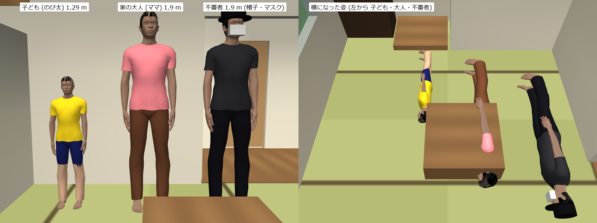
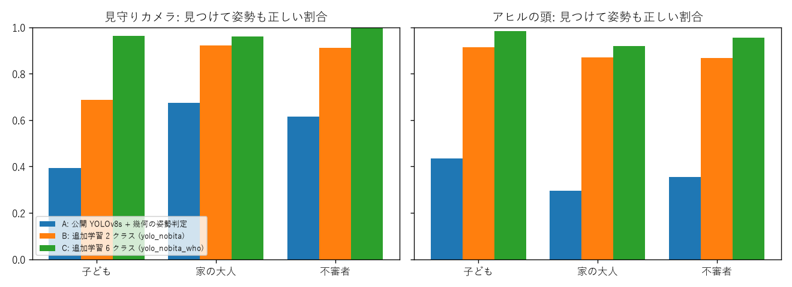
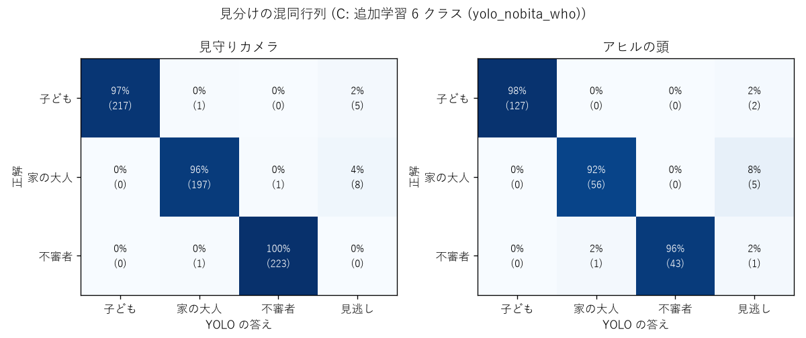

# 3 種類の人形と、だれかを見分ける YOLO (6 クラス)

## 人形

| 見た目 (`look`) | 人役 (`home.yaml` の people) | 大きさ | 服 |
|---|---|---|---|
| child | child (子ども) | 大人の形を 0.68 倍 (1.29 m) | 黄色のシャツ・紺の半ズボン |
| adult | mama (ママ) | 1.9 m | 桃色のシャツ・茶色のズボン |
| stranger | stranger (不審者、ふだんは家の外) | 1.9 m | 黒っぽい服、帽子 (円柱)、マスク (箱) |

- 作り方: `sim/scene.py` の `LOOKS`。メッシュ (Gazebo の person_standing) は 1 つで、見た目ごとに大きさと服の色を変える。
  元の T シャツ・ジーンズのテクスチャは暗いので、服はテクスチャを使わず色だけにした。体のメッシュは服の下の脚が無いので、
  半ズボンはズボンの膝から下を肌の色にして表す。
- 当たり判定のカプセルと、横になったときに床から浮かす高さ (0.13 m) も大きさに合わせる。
- `World` は `home.yaml` の people の `look` を読む (`World(looks=[...])` でも渡せる)。

## データと学習

- `learning/make_dataset.py`: 3 種類から 1〜3 人を選んで家のあちこち (居間・応接室・DK・廊下・子ども部屋・玄関の土間) に
  立たせる / 寝かせる。見守りカメラ 5 台とアヒルの頭のカメラで撮り、正解の枠はセグメンテーションで付ける。
  3000 場面 → 9301 枚 (学習 7431・検証 940・テスト 930)。`build/datasets/people3`
- クラス: `child_standing`、`child_lying`、`adult_standing`、`adult_lying`、`stranger_standing`、`stranger_lying`
- `learning/train_yolo.py`: 公開の YOLOv8s から 40 エポック (RTX 3060 で 59 分)。テストの mAP50 0.987、mAP50-95 0.951。
  重みは `models/yolo_person_who.pt` (前の 2 クラスの `models/yolo_person.pt` も残す)

## 結果 (`learning/eval_yolo.py`、テスト 930 枚・写っている人 888 人)

見つけた = IoU 0.5 以上・確信度 0.4 以上。表の全部は [eval_who.md](eval_who.md)。

| 方法 | 見つけた | 姿勢も正しい | だれかも正しい | 誤検出 (枠) |
|---|---|---|---|---|
| A: 公開 YOLOv8s + 幾何の姿勢判定 | 65.3% | 51.2% | - | 22 |
| B: 追加学習 2 クラス (yolo_person、大人の人形だけで学習) | 90.0% | 85.2% | - | 176 |
| C: 追加学習 6 クラス (yolo_person_who) | **97.6%** | **97.2%** | **97.2%** | 34 |

- 見分けの間違いは 888 人のうち 4 人 (子ども → 大人 1、大人 → 不審者 1、不審者 → 大人 2)。残りの誤りは見逃し (21 人)。
- 小さい人形の影響: 大人の人形だけで学習した B は、天井の見守りカメラで立っている子どもの姿勢を 45.6% しか当てられない
  (小さく見えて横になった人と間違える)。公開の YOLOv8s + 幾何 (A) でも 59.2% (頭の高さ 1.29 m が `STAND_HEIGHT` 1.5 m より低い)。
  C は 98.1%。

## 場面の確認 (小さい子ども + 6 クラスの重み、10/24 17:46、`build/runs/check_20261024_174616.md`)

`app/check_scenarios.py --only fall fall_dk fall_ousetsu fall_ok fall_hurt fall_silent hide_sofa hide_table hide_cupboard senmen_silent`
は 10 場面すべて PASS (メインのセッションのコミット前の変更も入っている)。括弧は前の確認 (10/24 01:51、大人の人形・2 クラス)。

| 場面 | 結果 |
|---|---|
| fall / fall_dk / fall_ousetsu | 倒れてから 12.6 (9.6) / 31.6 (29.6) / 24.6 (25.6) 秒で知らせ、アヒルが確認 |
| fall_ok / fall_hurt / fall_silent | 9.5 (6.5) / 8.5 (6.5) / 14.6 (9.5) 秒、判断 info / warn / emergency (期待どおり) |
| hide_sofa / hide_table / hide_cupboard | 157.8 (138.8) / 101.3 (72.7) / 70.7 (90.1) 秒で見つけた。転倒の誤報 0 回 |
| senmen_silent | 47.6 秒に声をかけに行き、emergency の知らせ (同じ) |
