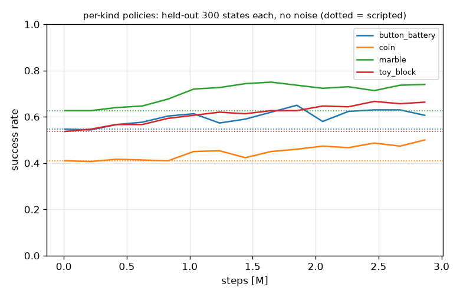
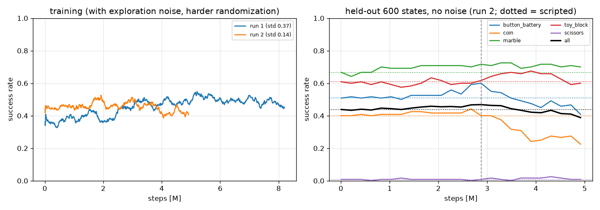

# Stretch 3 の拾う動きを強化学習で直せるか (2026-10-24)

結論:
- **種類ごとに学習した補正は、weld の補助なしでビー玉とブロックを良くした** (ビー玉 90.5 → 98.0%、ブロック 73.5 → 85.5%。各 200 回、差は 3σ ほど)。電池は変わらず、硬貨は +6 点で誤差の範囲。
- **weld の補助ありでは良くならない** (もともと 96〜100%)。硬貨は補助ありで 95.5 → 91.0% に下がる (挟む前に抜ける回数が増える)。
- 全種類を 1 つの方策で学習したとき (1・2 回目) は、ある種類が良くなると別の種類が悪くなり、合計では今の拾い方と同じだった。
- 家の場面は補助ありで動いているので、**今のまま (計算で決めた拾い方 + weld の補助) でよい**。補助なしで見せたいときだけ、ビー玉とブロックに補正を使うとよい。



## 結果 (種類ごとの方策、3 回目)

表 (200 回ずつ、[pick_rl_kind_eval.md](pick_rl_kind_eval.md)。条件は [pick_eval.md](pick_eval.md) と同じ: seed 0 (最初の 100 回は pick_eval.md と同じ場面)、noslip 3、制御 0.02 s、位置の見積もり ±1 cm):

| 物 | 計算 | 計算 + 種類ごとの補正 | 計算・weld 補助 | 計算 + 補正・weld 補助 |
|---|---|---|---|---|
| ボタン電池 | 75.0% | 75.5% | 96.0% | 97.5% |
| 硬貨 | 56.0% | 62.0% | 95.5% | **91.0%** |
| ビー玉 | 90.5% | **98.0%** | 100% | 100% |
| 小さいブロック | 73.5% | **85.5%** | 99.5% | 99.0% |

ハサミは学習していない (補助なしでは 0% で、指の目標を少し直すだけの補正では変わらない)。

- 種類ごとに 350 回 (約 290 万ステップ、1 種類 約 14 分)。探索の乱数 std 0.14 から。
- 学習に使わない場面 300 個 (種類ごと、seed 3) で、乱数なしの成功率を 25 回ごとに測り、一番良いものを残した (`learning/rl_pick/per_kind/policy_<種類>.npz`)。そこでの成功率は 電池 0.55 → 0.65、硬貨 0.41 → 0.50、ビー玉 0.63 → 0.75、ブロック 0.54 → 0.67 (学習の場面は位置の誤差 ±1〜2 cm・質量 ×0.7〜1.3 で、評価より難しい)。どの種類も最後まで上がり続けた。

## 全種類で 1 つの方策 (1・2 回目)

表 (100 回ずつ、[pick_rl_eval.md](pick_rl_eval.md)): 計算 299 / 500 → 補正 295 / 500 (補助なし)、459 → 449 (補助あり)。電池 +5・ビー玉 +4 だが硬貨 −13。1 回目は探索の乱数 std 0.37 で 820 万ステップ、2 回目は std 0.14 で 490 万ステップ (学習に使わない場面 600 個で選ぶ)。



## 何を学習したか

- **どこで**: CPU の MuJoCo (評価と同じ物理: Euler・noslip 3・timestep 0.005)。mjlab (MuJoCo Warp) は `noslip_iterations` を使うと `NotImplementedError` (コンテナの mujoco_warp で確認) で、noslip なしでは計算で決めた拾い方でもほぼ 0% なので、学習と評価の物理が合わず使わなかった。stable-baselines3 は `.venv` に無く、入れると共有の pyproject が変わるので、PPO は torch で書いた (`learning/rl_pick/train.py`、環境は numpy だけのプロセス 8 本)。
- **形**: 計算で決めた拾い方への補正 (残差)。台車の位置合わせ・下ろすまでは今のまま。指先が床に触れて閉じ始めてから、閉じる・挟む・持ち上げる・腕を縮めるまでの間、0.02 s ごとに lift・arm・wrist_roll・gripper の目標の補正と、指の力の上限の倍率を出す (`learning/rl_pick/residual.py`)。補正 0 なら今の拾い方と同じ。
- **観測 (28)**: 物の推定位置と掴む点の差、lift・arm・roll の動いた量、指の開き、掴む点の高さ、左右の指が物に触れているか・指先が何かに触れているか、段階 (閉じる/挟む/上げる/縮める) と経過時間、物の種類、幅、指の力、前の行動。
- **乱数**: 位置・向き・摩擦 0.5〜1.2・質量 ×0.7〜1.3・位置の見積もりの誤差 ±1〜2 cm・台車の止まる位置 (と、1・2 回目は種類)。閉じ始める所の状態を先に作り (`learning/rl_pick/env.py`、学習用 seed 1 で 6000 個)、そこから始める。
- **報酬**: 物の持ち上がった高さ (6 cm まで) の増えた分 + 成功 (5 cm 以上上げて 2 秒保つ、評価と同じ条件) で 1。

## なぜ大きくは良くならないか

失敗のほとんどは「持ち上げる途中で落とした」で、数 g の物を柔らかい接触で挟む物理の限界 (指先のパッドの向き、力を強めると物が押し出される) による ([pick_notes.md](pick_notes.md))。指の目標や力を少し変える補正では、厚みのある物 (ビー玉・ブロック) の持ち上げ方は直せたが、薄い物 (硬貨・電池) はほとんど変わらなかった。種類をまとめて学習すると、ある種類に効く補正が別の種類を悪くした。

## 家の場面で使うなら (提案)

`sim/stretch.py` は変えていない。使うなら Stretch の pick アクションで `pick_step` の代わりに次を呼ぶ (numpy だけで動く):

```python
from rl_pick.residual import ResidualPick, load_policy
pol = load_policy("learning/rl_pick/per_kind", kinds=("marble", "toy_block"))   # ほかの種類は今の拾い方
rp = ResidualPick(stretch, pol)          # pick を始めるたびに rp.reset()
status = rp.step((x, y, 0.0), yaw, width, kind)   # 'running' / 'done' / 'failed'
```

ただし補助ありでは良くならないので、補助ありの家の場面では使う意味はない。

## 再現

```
PYTHONUTF8=1 .venv/Scripts/python.exe learning/rl_pick/env.py --n 1200 --seed 1        # 学習の場面 6000 個 (約 5 分)
PYTHONUTF8=1 .venv/Scripts/python.exe learning/rl_pick/env.py --n 300 --seed 3         # 学習に使わない場面 1500 個
PYTHONUTF8=1 .venv/Scripts/python.exe learning/rl_pick/train.py --kinds marble --iters 350 --log-std -2.0 --eval-pool build/rl_pick/pool_s3.pkl --log build/rl_pick/kind_marble_log.json --out learning/rl_pick/per_kind/policy_marble.npz
PYTHONUTF8=1 .venv/Scripts/python.exe learning/eval_pick.py --kinds button_battery coin marble toy_block --n 200 --opt noslip --assist both --controller both --policy learning/rl_pick/per_kind --jobs 4 --out docs/learning/pick_rl_kind_eval.md
PYTHONUTF8=1 .venv/Scripts/python.exe learning/rl_pick/plot_curve.py
```
(ほかの種類も `--kinds` を変えて同じ。) 学習の記録と場面は `build/rl_pick/` (git に入らない)。メモリが少ないとき (YOLO の学習と同時など) は `eval_pick.py --jobs` を減らす (8 本で 1 本が落ち、全体が止まったことがある)。
