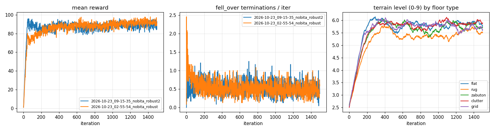
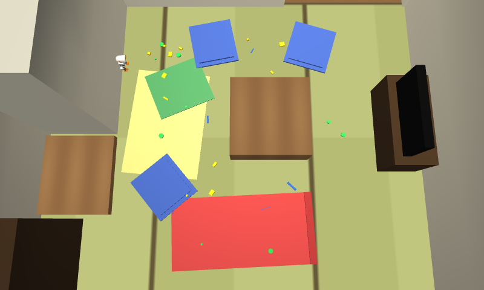

# 家の床で歩く方策 nobita_robust / nobita_robust2 (2026-10-23)

## 学習

| | nobita_robust (v1) | nobita_robust2 (v2) |
|---|---|---|
| タスク | Mjlab-Nobita-Clutter-Backlash-MicroDuck | Mjlab-Nobita-Clutter2-Backlash-MicroDuck |
| 温めた元 | 2026-10-19_01-45-26_nobita/model_1499 | 2026-10-23_02-55-54_nobita_robust/model_1499 |
| 座布団 | 30〜60 mm、接触はほぼ硬い (測ると 4 mm しか沈まない) | 30〜45 mm、約 2〜3 cm 沈む (床の下まである箱) |
| 地形の段の上げ下げ | mjlab の terrain_levels (4 m 進めば上) | 倒れずに 20 s 終えたら上、倒れたら下 |
| 到達した段 (0〜9) | 全員 0 段に落ちた | 約 5.7 で落ち着いた (どの床も) |
| チェックポイント (コンテナ) | `~/ext/microduck_rl/logs/rsl_rl/velocity/2026-10-23_02-55-54_nobita_robust/model_1499.pt` | `~/ext/microduck_rl/logs/rsl_rl/velocity/2026-10-23_09-15-35_nobita_robust2/model_1499.pt` |
| ONNX | models/nobita_robust.onnx | models/nobita_robust2.onnx |
| 学習曲線 | rl_robust_curve.png | rl_robust2_curve.png |

共通: 床は 平ら 25% / 敷物 5〜15 mm 20% / 座布団 15% / おもちゃ 10〜25 mm 25% / ゆるい凸凹 ±6 mm 15%。
足裏の摩擦 0.4〜1.2 (床の geom は 0.4)。押し (±0.3 m/s、3〜6 秒ごと) は元のまま。2048 env × 1500 iter、約 2 h (RTX 3060、4096 env は GPU メモリ不足)。
ソース: learning/rl/ (nobita_clutter_env_cfg.py、install.sh、train.sh、plot_curve.py)。ONNX はどれも obs 61 / action 14 (nobita_walk.onnx と同じ形)。

## 評価 (learning/eval_robust.py)
居間に敷物 2 枚 (+重ね 1 枚、めくれ 12 mm)、座布団 3 枚 (35〜45 mm、v2 と同じ柔らかさで約 3 cm 沈む)、おもちゃ 28 個を置き、
4 本の道 × seed 3 = 12 本。push: 3〜5 秒ごとに Δv 0.35 m/s (0.1 s)。倒れたら 10 秒待ち、立ち直れば続ける。
「止まった道」は stuck (12 秒進まない) / 起き上がれなかった の数。

### 方策だけ (`--recovery own`、sim/duck.py の velstand への切り替えを止める) — robust_eval.md

| 方策 | 条件 | 到着率 | 転倒 (回) | 転倒した道 | 起き上がり | 止まった道 (stuck / 起きられず) | 到着までの平均 [s] |
|---|---|---|---|---|---|---|---|
| velstand | flat | 100% (12/12) | 0 | 0/12 | - | 0 / 0 | 32.5 |
| velstand | clutter | 17% (2/12) | 35 | 9/12 | 35/35 | 6 / 0 | 49.4 |
| velstand | flat+push | 100% (12/12) | 6 | 6/12 | 6/6 | 0 / 0 | 33.2 |
| velstand | clutter+push | 83% (10/12) | 35 | 10/12 | 34/35 | 1 / 1 | 41.6 |
| nobita_walk | flat | 100% (12/12) | 0 | 0/12 | - | 0 / 0 | 13.5 |
| nobita_walk | clutter | 8% (1/12) | 11 | 11/12 | 0/11 | 0 / 11 | 14.8 |
| nobita_walk | flat+push | 58% (7/12) | 5 | 5/12 | 0/5 | 0 / 5 | 9.4 |
| nobita_walk | clutter+push | 8% (1/12) | 11 | 11/12 | 0/11 | 0 / 11 | 8.8 |
| nobita_robust | flat | 100% (12/12) | 0 | 0/12 | - | 0 / 0 | 15.5 |
| nobita_robust | clutter | 8% (1/12) | 11 | 11/12 | 0/11 | 0 / 11 | 15.6 |
| nobita_robust | flat+push | 75% (9/12) | 3 | 3/12 | 0/3 | 0 / 3 | 14.3 |
| nobita_robust | clutter+push | 8% (1/12) | 11 | 11/12 | 0/11 | 0 / 11 | 16.3 |
| nobita_robust2 | flat | 100% (12/12) | 0 | 0/12 | - | 0 / 0 | 19.0 |
| nobita_robust2 | clutter | 8% (1/12) | 11 | 11/12 | 0/11 | 0 / 11 | 22.5 |
| nobita_robust2 | flat+push | 33% (4/12) | 8 | 8/12 | 0/8 | 0 / 8 | 14.1 |
| nobita_robust2 | clutter+push | 8% (1/12) | 11 | 11/12 | 0/11 | 0 / 11 | 18.6 |

### アプリと同じ (`--recovery velstand`、倒れたら velstand で起き上がる) — robust_eval_velstand.md

| 方策 | clutter | flat+push | clutter+push | flat の到着まで [s] |
|---|---|---|---|---|
| velstand | 17% (2/12) | 100% | 83% (10/12) | 32.5 |
| nobita_walk + velstand | **67% (8/12)** | **100%** | 67% (8/12) | **13.5** |
| nobita_robust + velstand | 33% (4/12) | 100% | **75% (9/12)** | 15.5 |
| nobita_robust2 + velstand | 25% (3/12) | 92% (11/12) | 50% (6/12) | 19.0 |

倒れた場所 (方策だけ、clutter): nobita_* はどれも、道の最初の座布団で倒れる (座布団 8〜9 回、敷物 1〜2 回、おもちゃ 0〜1 回)。velstand は座布団 29 回。

### 歩く速さ (learning/eval_gait.py、居間の広い所、6 秒)

| 指令 vx | nobita_walk | nobita_robust | nobita_robust2 |
|---|---|---|---|
| 0.3 m/s | 0.111 | 0.134 | 0.122 |
| 0.4 m/s | **0.343** | 0.158 | 0.155 |
| 旋回 wz=1.0 | 0.48 rad/s | 0.03 | 0.41 |

## わかったこと
1. **学習し直しても、家の中では強くならなかった。** v2 は学習の床 (段 5.7、座布団 30〜45 mm も含む) ではほとんど倒れないのに、
   居間ではどの nobita_* も最初の座布団で倒れる (8%)。押しへの強さも v1 (75%) > nobita_walk (58%) > v2 (33%) で、v2 は悪くなった。
2. **温めた方策は遅くなった。** 0.4 の指令で 0.34 → 0.16 m/s。「倒れなければ段が上がる」ので、ゆっくり歩くのが得になった可能性がある。
   v1 はその場で回れない (0.03 rad/s)。
3. 学習の床と居間の違いとして考えられるもの: 学習のタイル (8 m 四方) では座布団がまばらで、1 回 (20 s、遅いと 3 m ほど) の間に
   座布団を正面から越える場面が少ない。居間の道はわざと座布団の真ん中を通している。
   (当たり判定の違いは原因ではない: 学習のモデルも家のモデルも、すね・足裏の geom は同じ。家のモデルで増えるのは腰・頭で高さ 10 cm 以上)
4. **いま一番よい組み合わせは nobita_walk + 倒れたら velstand** (sim/duck.py の今のやり方): 散らかった居間 67%、押し 100%、速さもいちばん。
   柔らかい座布団の近くで倒れても velstand で 9 割以上起き上がる。nobita_robust + velstand は押しのある散らかった居間だけ少しよい (75%)。
5. 座布団は「越える」より「避ける」のが確実。経路 (FloorMap) で座布団を障害物にすれば、散らかった居間の転倒の大半がなくなる。

## 次にやるなら (未実施)
- 学習の座布団を密に (道をふさぐように並べる) し、タイルを小さく (2〜3 m) して、毎回座布団を正面から越えさせる
- 遅くならないように、速度追従の報酬を重く / 「倒れなかった」だけでなく「指令の距離の何割進んだか」も段の上げ下げに入れる
- 家のモデル (robot_groundcontact_backlash.xml) で学習する
